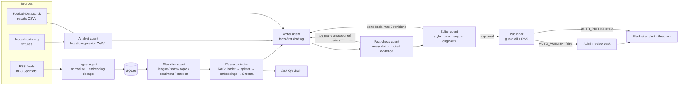

# Touchline Takes

**AI-powered football takes, straight from the touchline.** Target domain: touchlinetakes.com

Touchline Takes is a football news site run by an automated, multi-agent newsroom.
Stories move through specialised agents: ingest, classify, research, analyse, write,
fact-check, edit and publish. A Flask site shows what the pipeline publishes, and a
human editor can approve or reject drafts before they go live.

Two rules hold throughout:

- **Never publish a claim without a source.** Every factual sentence carries a citation
  such as `[S1]` that points to a source story, a results-data record, a fixture or a model
  output. A claim that can't be traced is removed, sent back to the Writer, or blocked when
  the Publisher runs its final check.
- **Never republish source articles.** The newsroom writes its own summaries and opinion.
  It quotes only headlines and short fragments, always with attribution, and links to every
  source.

Everything runs **offline by default**, with no API keys. It falls back to bundled sample
feeds, synthetic results data, template writing, a lexicon classifier and TF-IDF embeddings.
Configure the real providers when you have them (see [Going online](#going-online)).

---

## Architecture



The same flow in plain text:

```
ingest → classifier → research index → analyst
       → [ writer → factcheck → editor ]  ← repeat while drafts need revision (max 2 revisions)
       → publisher → (admin review | auto-publish) → site + RSS
```

### Agent interface

Each agent is a plain Python class with one method:

```python
class Agent(ABC):
    name = "agent"
    def run(self, state: NewsroomState) -> NewsroomState: ...
```

`NewsroomState` (`touchline_takes/state.py`) is the shared state object. It holds new
stories, classified stories, drafts (with their evidence, claims, feedback and rejection
history), fixtures, metrics and a per-story log. Tools such as the database, LLM, embeddings,
retriever and predictor are passed in through the constructor, so you can test each agent on
its own with fakes.

**Moving to LangGraph later** is mechanical:

1. Make `NewsroomState` a `TypedDict` (or a Pydantic model) and use it as the graph state.
2. `graph.add_node(agent.name, agent.run)` for each agent in `pipeline.py`.
3. Replace the `for rounds in ...` loop in `Newsroom.run_once` with a conditional edge from
   `editor` back to `writer` (`"needs_revision" in statuses and revision < MAX_REVISIONS`),
   and from `factcheck` back to `writer`.
4. The RAG pieces mirror LangChain's interfaces (`Document`, `embed_documents`/`embed_query`,
   vector store, retriever, QA chain), so `langchain_chroma.Chroma` and a LangChain retrieval
   chain can drop in.

---

## Install

Requires Python 3.11+ (verified on 3.13).

```bash
python -m venv .venv
```

```bash
source .venv/bin/activate
```

```bash
pip install -r requirements.txt
```

```bash
cp .env.example .env   # optional; every key is optional
```

All dependencies are pinned and were verified together with `pip check` in a clean venv.
Provider SDKs are plain HTTP calls or the official `anthropic` SDK. No LangChain or Gradio
is used, so the FastAPI/Starlette version conflicts don't come up.

## Run

**One command runs the whole pipeline once:**

```bash
python -m touchline_takes.run --offline --auto-publish
```

Drop `--offline` to try the real RSS feeds first; it falls back to samples if they're
unreachable. Drop `--auto-publish` to send approved drafts to the review desk instead
(the default, `AUTO_PUBLISH=false`).

**Scheduled mode** (every 30 minutes; `--max-runs N` to stop after N):

```bash
python -m touchline_takes.run --schedule 30
```

Each run prints what every agent did, per story, followed by a JSON summary. The same log
goes into SQLite and shows on the review desk.

**Website:**

```bash
flask --app "touchline_takes.web:create_app()" run
```

| Page | What it does |
|---|---|
| `/` | Latest takes, plus upcoming fixtures with the Analyst's win/draw/loss probabilities |
| `/article/<slug>` | An article with footnoted citations and a "Sources & data" list |
| `/ask` | Ask questions about the stored news (RAG with source links) |
| `/feed.xml` | RSS feed of Touchline Takes' own articles |
| `/admin` | Review desk: approve or reject drafts, see the fact-check table for each draft, the rejection log, recent runs and the agent log. You can also trigger a run from here. HTTP Basic auth: user `admin`, password `ADMIN_PASSWORD`. With no password set, only localhost can open it. Forms are CSRF-protected. |

## Test, lint, evaluate

```bash
python -m pytest
```

```bash
pylint touchline_takes tests scripts
```

```bash
python scripts/evaluate.py
```

- **Tests** (86) cover every agent and tool. The suite blocks real HTTP in `tests/conftest.py`
  and uses fake sessions, `FakeLLM`, `RecordedLLM` (`tests/fixtures/recorded_llm.json`) and
  `ScriptedWriterLLM`, so it needs no network or API keys.
- **Pylint** scores 10.00/10 with the config in `pyproject.toml`.
- **Evaluation** runs the full pipeline on `data/eval/fixture_stories.json` (25 labelled
  stories with expected outcomes) in two configurations: the offline template writer, and a
  scripted fake LLM writer that, for flagged stories, invents claims and swaps facts around
  (flipped winners, stats pinned on the wrong team). It also scores the fact-checker on
  `data/eval/claim_cases.json`: 56 labelled claims, including correct paraphrases to measure
  false alarms, split into a `dev` set used while building the checks and a `heldout` set
  written afterwards. The report (`reports/evaluation.md` / `.json`) includes:
  - the share of claims with a source, on first drafts and in published articles
  - contradictions caught, the Editor rejection rate and fact-check bounces
  - fact-checker precision, recall and false-positive rate, token-only vs relation-aware
  - retry counts
  - expectation pass rate
  - LLM calls, tokens, cost (actual and projected for Claude) and latency per article
  - classifier accuracy
  - predictor metrics against baselines

  The script exits non-zero if any published claim has no source, or if the model doesn't
  beat the baseline.

Latest snapshot (`reports/evaluation.md`):

| | template writer | scripted LLM writer |
|---|---|---|
| Claims with a source: first pass / published | 1.00 / **1.00** | 0.88 / **1.00** |
| Unsupported claims caught (of which contradictions) | 0 (0) | 32 (14) |
| Editor rejection rate | 0.42 | 0.42 |
| Retries (total / max per draft) | 10 / 2 | 20 / 2 |
| Expectations passed | 19/19 | 19/19 |

| Fact-checker on labelled claims | Recall on bad claims | False-positive rate |
|---|---|---|
| Token-only (old), held-out 18 | 0.30 | 0.00 |
| Relation-aware (new), held-out 18 | **1.00** | 0.00 |

| Match-outcome model (test set, 278 matches) | Logistic regression | Majority-class baseline |
|---|---|---|
| Accuracy | **0.543** | 0.450 |
| Macro F1 | **0.406** | 0.207 |
| ROC-AUC (one-vs-rest) | **0.671** | 0.500 |

---

## The agents

### 1. Ingest (`agents/ingest.py`, `tools/feeds.py`)
- Fetches RSS feeds (`RSS_FEEDS`, BBC Sport football by default) with `requests` and parses
  them with `feedparser`.
- Normalises each item into a `Story`: HTML stripped, ISO date, stable id from the URL.
- Drops stories whose URL it has already seen, then drops **near-duplicates by embedding
  similarity** (cosine ≥ `DEDUPE_THRESHOLD`, default 0.8) against the batch and the last 300
  stored stories. For example, the same match report from two outlets scores 0.90; unrelated
  stories score below 0.15.
- Stores new stories in SQLite.
- If every feed fails, or `--offline` is set, it uses `data/sample_feeds/*.xml` and logs that.

### 2. Classifier (`agents/classifier.py`, `tools/teams.py`)
- Tags each story with **league, teams, topic** (match_report, transfer, injury, manager,
  discipline, preview, general), **sentiment** and **emotion** (joy, anger, sadness, fear,
  surprise, neutral).
- `LexiconClassifier` works offline. It uses a team/alias directory (`data/teams.json`),
  weighted keyword topics, and a sentiment/emotion lexicon with negation.
- `LLMClassifier` (`CLASSIFIER_PROVIDER=llm`) asks the configured hosted LLM for JSON, checks
  every label against the allowed set, and falls back to the lexicon on any failure.

### 3. Writer (`agents/writer.py`)
- Plans post-match takes, explainers (transfers, injuries, dugout changes, refereeing rows)
  and previews of upcoming fixtures, within `MAX_ARTICLES_PER_RUN`.
- **Facts-first generation:** it builds evidence records (`S*` stories and related coverage
  from the RAG retriever, `ST*` results-data form and head-to-head, `F*` fixtures, `M*`
  Analyst predictions) and turns them into short grounded fact sentences, each with a
  citation.
- Adds opinion lines ("takes") that contain no names or numbers, and finishes with
  *"The Touchline Take: …"*.
- With an LLM configured, the model restyles the facts in the house voice under strict
  instructions. Offline, a deterministic template composer writes the piece.
- If the LLM fails or the call budget runs out, it falls back to templates and logs it.
- Revises drafts sent back by the Fact-checker or Editor, using their feedback.

### 4. Fact-check + Editor (`agents/factcheck.py`, `agents/editor.py`)
- **Fact-check.** A sentence is a *claim* if it has numbers or proper nouns. Each claim
  goes through these checks in order:
  1. **Citation:** it cites known evidence.
  2. **Tokens:** every number and proper noun in it appears in the cited records.
  3. **Relations** (`tools/relations.py`), which catch claims that use the source's words but
     get the facts the wrong way round:
     - **Result direction and score:** results are read from many phrasings ("beat",
       "lost 2-1 to", "stunned 2-0 by", "3-0 defeat at", "X 0-2 Y", draws), so
       "Chelsea beat Arsenal 2-1" fails against "Arsenal beat Chelsea 2-1", as does a win
       claimed for a drawn game.
     - **Team–number attribution:** for stats, model and fixture records, each number belongs
       to the team named before it (with its unit), so swapping two teams' form or win
       probabilities fails even when both records are cited.
     - **Number–unit pairing:** "out for 6 months" fails against "6 weeks".
  4. **Optional LLM verifier** (`FACTCHECK_VERIFIER=llm`): one batched call per draft asks
     the LLM whether each claim that passed the rules is fully supported by its evidence.
     It counts against the LLM budget, and if the call fails, the rule verdicts stand.

  What happens next:
  - A few unsupported claims are removed.
  - If more than 25% of claims are unsupported, the lead claim is, or **any claim contradicts
    its source**, the draft goes back to the Writer.
- **Editor.** Checks:
  - length (90–450 words)
  - title length
  - banned phrases
  - exclamation marks and shouting
  - that the piece has an opinion and a verdict line
  - that it has at least 3 sourced claims
  - originality (no 10-word run copied from a source outside quotes)
  - that at least one source is linked
- **Bounded retry loop:** at most `MAX_REVISIONS=2` revisions. After that the draft is
  rejected. Every rejection reason goes to the `rejections` table, the draft's
  `rejection_history` and the review desk.

### 5. Research tools / RAG (`tools/rag.py`, `tools/embeddings.py`)
- The chain: `StoryLoader` → `SentenceTextSplitter` → embeddings → `ChromaVectorStore`
  (persistent, telemetry off, embeddings computed by us so no model downloads; in-memory
  fallback) → `Retriever` → `QAChain`.
- The Writer uses `related()` to pull in related coverage.
- Visitors use `/ask`. With an LLM configured, it writes a cited answer from the retrieved
  context. Offline, it gives an extractive answer ranked by TF-IDF.
- Providers are set by environment variables:
  - `EMBEDDINGS_PROVIDER=tfidf` (offline hashed TF-IDF) or `openai` (any OpenAI-compatible
    `/embeddings` endpoint)
  - `LLM_PROVIDER=offline|anthropic|openai`

### 6. Analyst (`agents/analyst.py`, `models/match_predictor.py`)
- **Multinomial logistic regression** (StandardScaler + LogisticRegression) predicting
  home win, draw or away win.
- Features are Elo difference and rolling 5-match form (points per game, goals for and
  against), computed only from matches *before* each fixture, so there's no leakage.
- **Chronological train/test split** (earliest 75% for training, latest 25% for testing).
- Evaluated on accuracy, macro precision, recall and F1, one-vs-rest ROC-AUC, log-loss and the
  confusion matrix, against **majority-class and class-prior baselines**. After evaluation it
  refits on all the data.
- Predicts upcoming fixtures (football-data.org if `FOOTBALL_DATA_API_KEY` is set, otherwise
  `data/fixtures/sample_fixtures.json`). Predictions show next to the fixtures on the home page
  and feed the Writer's previews as `M1` evidence.

### 7. Publisher (`agents/publisher.py`)
- Runs the "no unsourced claim" guardrail once more, then either queues the draft for
  `/admin` review or, with `AUTO_PUBLISH=true`, publishes it.
- Gives each article a unique slug and stores it with its sources and evidence.
- `build_rss()` serves `/feed.xml`.

### 8. Stretch: image tagging (not built)
VGG16 transfer learning for match photos is left for later. See [Next steps](#next-steps).

---

## Guardrails and cost controls

- **No unsourced claims:** checked by the Fact-checker, again by the Editor, and once more by
  the Publisher before anything goes live. The evaluation fails if a published claim has no
  source.
- **LLM budget:** at most `LLM_MAX_CALLS_PER_RUN` uncached calls per run. Past that,
  `BudgetExceeded` is raised and agents fall back to offline behaviour.
- **LLM cache:** responses are cached in SQLite, keyed by provider, model, system, prompt and
  max_tokens. Cache hits are free and don't count against the budget.
- **Cost and latency** are tracked for each draft and each run (`llm_calls`, tokens, USD,
  seconds).
- **Secrets** come only from environment variables or a git-ignored `.env`. Nothing secret
  is committed.

## Going online

The development sandbox for this build **couldn't reach outside hosts**. RSS, football-data
and LLM APIs were refused by the network proxy, so the repo ships fallbacks:

| Mocked / sample | Where | How to switch to real |
|---|---|---|
| RSS stories (fictional, "Sample Sports Wire" / "Sample Football Desk") | `data/sample_feeds/` | Run without `--offline`; the default `RSS_FEEDS` is BBC Sport football. |
| Results data (**synthetic**, Football-Data.co.uk format, 3 seasons) | `data/results/sample_E0_*.csv`, generated by `scripts/make_sample_data.py` | `python scripts/download_football_data.py --league E0 --seasons 2223 2324 2425 --replace`, then `python -m touchline_takes.run --retrain` |
| Upcoming fixtures | `data/fixtures/sample_fixtures.json` | Set `FOOTBALL_DATA_API_KEY` (free at football-data.org). |
| LLM writer / classifier / QA | templates, lexicon, extractive QA | `LLM_PROVIDER=anthropic` + `ANTHROPIC_API_KEY` (defaults to `claude-opus-5-5`, with server-side refusal fallback), or `LLM_PROVIDER=openai` + `OPENAI_API_KEY` / `OPENAI_BASE_URL` (works with OpenAI, Ollama, vLLM). Optionally `CLASSIFIER_PROVIDER=llm`. |
| Embeddings | hashed TF-IDF | `EMBEDDINGS_PROVIDER=openai` (uses a separate Chroma collection) |

Articles always say where their numbers come from. While the synthetic data is in place,
stats sentences read "In our synthetic sample results, …".

No IBM watsonx dependency: every provider is optional and has an offline fallback.

## Configuration

See `.env.example` for every variable. The main ones:

- `LLM_PROVIDER`, `LLM_MODEL`, `LLM_MAX_CALLS_PER_RUN`
- `EMBEDDINGS_PROVIDER`, `VECTOR_STORE`
- `CLASSIFIER_PROVIDER`, `FACTCHECK_VERIFIER`
- `AUTO_PUBLISH`, `MAX_REVISIONS`, `MAX_ARTICLES_PER_RUN`, `DEDUPE_THRESHOLD`
- `ADMIN_PASSWORD`, `SECRET_KEY`, `DATABASE_PATH`

## Project layout

```
touchline_takes/
  agents/      ingest, classifier, writer, factcheck, editor, analyst, publisher (+ base Agent)
  tools/       llm (providers, cache, budget, fakes), embeddings, feeds, football_api,
               rag, relations, stats, teams, text
  models/      match_predictor (logistic regression + baselines)
  db/          SQLite repository
  web/         Flask app factory, views, templates, static
  pipeline.py  orchestrator      run.py  CLI      evaluation.py  evaluation harness
  config.py    settings from env state.py shared state objects
tests/         unit + end-to-end tests (offline)
data/          sample feeds, synthetic results, fixtures, teams, eval fixtures
scripts/       evaluate.py, make_sample_data.py, download_football_data.py
reports/       latest evaluation report
```

## Next steps

1. **Switch on real data and a real LLM.** Download the Football-Data.co.uk CSVs and retrain,
   point at live RSS, set `LLM_PROVIDER`, then re-run `scripts/evaluate.py` and record a
   `RecordedLLM` fixture from real outputs.
2. **Harden the fact-checker further.** The relation checks cover results, team stats and
   units. Relations involving people ("Hartmann scored" vs "Reyes scored"), number words
   ("six") and tables/positions ("second in the league") are still checked only at the token
   level. Measure the LLM verifier on the claim set with a real model, and grow the
   held-out claim set from real articles written by someone who hasn't seen the rules.
3. **Port the orchestration to LangGraph and add image tagging.** Add persistence and
   human-in-the-loop interrupts for the review step, then a VGG16 transfer-learning tagger
   for match photos.
