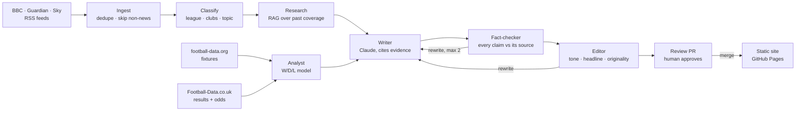

# Touchline Takes

**An AI newsroom that writes football news, and checks every claim before it's published.**

🌐 **Live:** [touchlinetakes.com](https://touchlinetakes.com) · 📊 **Production numbers:** [How we check](https://touchlinetakes.com/how-we-check/)

Touchline Takes is a football news and opinion site run by a multi-agent pipeline. Twice a
day it reads the news (BBC Sport, The Guardian, Sky Sports), picks the stories worth
covering, writes original takes with Claude, **fact-checks every factual sentence against
the source it cites**, edits for tone and originality, and sends each draft to a human editor
as a pull request. Merging the pull request publishes the article.

It runs on free infrastructure (GitHub Actions and GitHub Pages) for about **$1 a month** in
model costs.

---

## In production

Numbers from the newsroom's own records (snapshot, 11 Nov 2026; the live figures are on
[How we check](https://touchlinetakes.com/how-we-check/), rebuilt with the site):

| | |
|---|---|
| Factual claims fact-checked | **322** |
| Unsupported claims caught before publication | **39 (12%)** |
| Drafts written / published | 35 / 16 |
| Cost per published article (Claude Haiku 5.5) | **≈ $0.005** |
| Match model on held-out matches | 45% correct, ROC-AUC 0.62 (0.50 = guessing) |
| Automated tests | 197, offline (no network or API keys) |

The predictions scorecard on the same page grades every pre-match prediction against the
real result and against **Bet365's odds** for the same match.

## How it works



1. **Ingest** pulls three RSS feeds, drops duplicates by embedding similarity, and sets aside
   what isn't football news: live blogs, videos, newsletters, other sports and (for now)
   women's football.
2. **Classify** tags league, clubs and topic (result, transfer, sacking, injury…).
3. **Research** retrieves related coverage with a RAG chain (loader → splitter →
   embeddings → Chroma → retriever).
4. **Analyst** predicts upcoming fixtures with a logistic-regression model trained on real
   results (Elo difference and rolling form, chronological split, baselines).
5. **Writer** builds an evidence pack (stories `S1`, form tables `ST1`, fixtures `F1`,
   predictions `M1`) and has Claude write an original take in which every factual sentence
   cites one of those records.
6. **Fact-checker** tests each claim against what it cites (below). Unsupported lines are
   cut; drafts with wrong facts go back for a rewrite, and fail after two.
7. **Editor** checks length, tone, headline, that there's an actual opinion, and that no
   10-word run is copied from a source.
8. **Publisher** opens a GitHub pull request per approved draft, with the article, its
   sources and a one-click "Post to X" link. Merging it deploys the site.

The pipeline is a **LangGraph** `StateGraph` with a conditional revision loop and a
human-in-the-loop `interrupt()` (in server mode the run pauses for review and resumes from a
SQLite checkpoint).

## Engineering highlights

- **Citation-grounded fact-checking.** A claim is any sentence with a name or a number, and
  it must cite evidence. The checker goes beyond word matching: it reads results from many
  phrasings ("lost 2-1 to", "X 0-2 Y", draws) and fails a claim that reverses the winner; it
  ties each statistic to the club named before it, so swapped figures fail; it pairs numbers
  with units (6 *weeks* ≠ 6 *months*). On a held-out set of labelled claims, recall on
  fabricated claims went from 0.30 (token matching) to 1.00.
- **GitOps publishing on free infrastructure.** The newsroom's state (SQLite and results
  data) lives on an orphan branch, restored and force-pushed by each run. Articles are JSON
  files in the repo, validated at build time so a hand edit can't introduce an unsourced
  claim, and every draft arrives as a pull request for review.
- **Honest model evaluation.** The match predictor is trained on chronological splits,
  compared with majority-class and class-prior baselines, and now graded live against the
  bookmaker on matches it predicted before kick-off.
- **Cost control.** Claude Haiku 5.5 by default, an LLM call budget per run, a response
  cache, and template fallbacks that refuse to write stories they can't add anything to.
  The fact-checker and editor make no model calls.
- **Production hygiene.** Preflight checks that refuse unsafe production settings, a CSP
  with no inline scripts, rate limits, pinned dependencies, pylint 10/10 and an offline test
  suite with fake LLMs that simulate hallucinations.

## Lessons from production

The first live runs surfaced problems no sample data had:

- **A season read as a score.** "Sheffield Wednesday in 1904-05" became "the game ended
  1904-05". Scores are now 1–2 digits a side, and the headline must show a match.
- **The feeds weren't what they said.** Sky's "football" feed carried F1 and NFL; the
  Guardian's included newsletters ("Sign up now!" quoted as a detail), podcasts and women's
  football that named no women's team. Ingest now filters by URL section, format, and the
  Guardian's own categories.
- **Over-constrained prompts make thin articles.** Telling Claude to add nothing beyond a
  few starter facts produced weak copy. Letting it use anything in the cited evidence, with
  the fact-checker as the guard, made the articles good without letting unsupported claims
  through (it still caught a manager's name Claude added from outside the source).
- **A strict checker can block good work.** Single uncited opinion lines were rejecting
  sound drafts; they're now cut instead. A curly apostrophe ("City’s") was failing a true
  claim.
- **Old state outlives new rules.** Stories stored before a fix came back with stale labels,
  so the classifier re-tags waiting stories whenever its rules change.
- **APIs cost money in unexpected places.** Automatic posting to X needs paid credits, so
  sharing became a one-click "Post to X" link in each review PR (plus free Bluesky posting).

## Tech stack

Python 3.13 · LangGraph · Anthropic API (Claude Haiku 5.5) · scikit-learn · pandas ·
Chroma · Flask + Jinja · SQLite · Keras 3 (JAX) for an optional VGG16 photo tagger ·
GitHub Actions · GitHub Pages · pytest · pylint

## Run it locally

```bash
python -m venv .venv
```

```bash
source .venv/bin/activate
```

```bash
pip install -r requirements-dev.txt
```

```bash
python -m touchline_takes.run --offline --auto-publish
```

```bash
flask --app "touchline_takes.web:create_app()" run
```

`--offline` uses bundled sample feeds and synthetic results, with template writing instead of
Claude, so no keys are needed. Tests: `python -m pytest`. Lint:
`pylint touchline_takes tests scripts`. Offline evaluation: `python scripts/evaluate.py`.

## Documentation

- **[docs/ARCHITECTURE.md](docs/ARCHITECTURE.md)**: every agent in detail, the LangGraph
  graph, the evaluation harness, configuration and the project layout.
- **[DEPLOY.md](DEPLOY.md)**: running it on GitHub Actions and Pages (free), or on your own
  server with Docker.

## Limitations and next steps

- The scorecard needs a few match rounds before its numbers mean much.
- The offline evaluation uses sample data; the next step is a labelled set built from real
  production drafts, including the mistakes the checker caught.
- Relations involving people ("X scored") and league positions are checked at the word level
  only.
- Women's football and leagues beyond the Premier League aren't covered yet.
