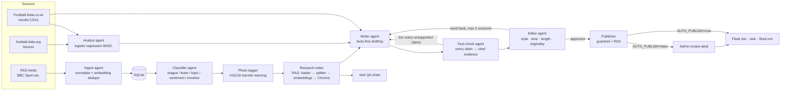
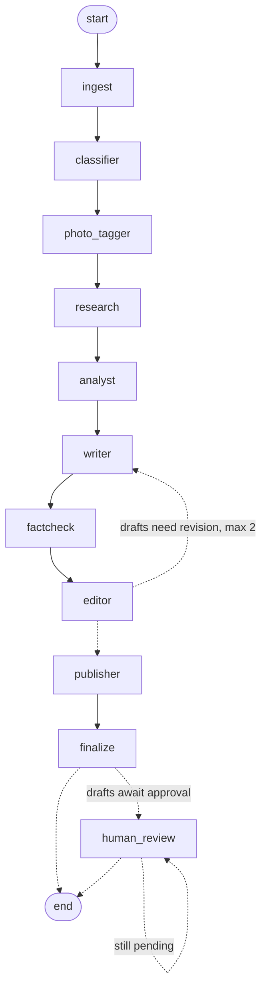

# Touchline Takes

**AI-powered football takes, straight from the touchline.** Target domain: touchlinetakes.com

Touchline Takes is a football news site run by an automated, multi-agent newsroom.
Stories move through specialised agents: ingest, classify, research, analyse, write,
fact-check, edit and publish. A Flask site shows what the pipeline publishes, and a
human editor can approve or reject drafts before they go live.

Two rules hold throughout:

- **Never publish a claim without a source.** Every factual sentence carries a citation
  such as `[S1]` that points to a source story, a results-data record, a fixture or a model
  output. A claim that can't be traced is removed, sent back to the Writer, or blocked when
  the Publisher runs its final check.
- **Never republish source articles.** The newsroom writes its own summaries and opinion.
  It quotes only headlines and short fragments, always with attribution, and links to every
  source.

Everything runs **offline by default**, with no API keys. It falls back to bundled sample
feeds, synthetic results data, template writing, a lexicon classifier and TF-IDF embeddings.
Configure the real providers when you have them (see [Going online](#going-online)).

---

## Architecture



### Orchestration: LangGraph

The pipeline runs as a **LangGraph `StateGraph`** (`touchline_takes/graph.py`). This is the
actual compiled graph, printed by `python -m touchline_takes.graph` (dotted lines are
conditional edges):



- **Nodes:** each agent is a node. The graph state (`GraphState`) carries the
  `NewsroomState` object and a revision-round counter. Nodes are timed and isolated from
  failures, so one agent erroring doesn't sink the run.
- **Revision loop:** this is the conditional edge `editor → writer`. Drafts the Fact-checker
  or Editor sends back are rewritten, at most `MAX_REVISIONS` times.
- **Human in the loop:** with `AUTO_PUBLISH=false`, the `human_review` node calls LangGraph's
  `interrupt()`. The run **pauses**, and its full state is saved to a SQLite checkpoint
  (`CHECKPOINT_PATH`, one thread per run). Approving or rejecting a draft in `/admin`, or
  with `python -m touchline_takes.review`, resumes that run's thread with the decision. The
  node loops until nothing is pending, then the run ends. The web app and the CLI can resume
  runs started by another process.
- **Persistence:** checkpoints only reload the newsroom's own state classes; they are
  registered explicitly with LangGraph's serializer.
- **Sequential fallback:** `ORCHESTRATOR=sequential` (or `--orchestrator sequential`) runs
  the same agents in a plain Python loop, with no checkpoints. A test checks that both
  orchestrators make identical editorial decisions.

### Agent interface

Each agent is a plain Python class with one method:

```python
class Agent(ABC):
    name = "agent"
    def run(self, state: NewsroomState) -> NewsroomState: ...
```

`NewsroomState` (`touchline_takes/state.py`) is the shared state object. It holds new
stories, classified stories, drafts (with their evidence, claims, feedback and rejection
history), fixtures, metrics and a per-story log. Tools such as the database, LLM, embeddings,
retriever and predictor are passed in through the constructor, so you can test each agent on
its own with fakes.

Agents don't know about LangGraph: each node wraps an agent's `run` method, so every agent
is still testable on its own. The RAG pieces mirror LangChain's interfaces (`Document`,
`embed_documents`/`embed_query`, vector store, retriever, QA chain), so
`langchain_chroma.Chroma` and a LangChain retrieval chain can drop in.

---

## Install

Requires Python 3.11+ (verified on 3.13).

```bash
python -m venv .venv
```

```bash
source .venv/bin/activate
```

```bash
pip install -r requirements-dev.txt   # runtime deps + pytest/pylint
```

```bash
cp .env.example .env   # optional; every key is optional
```

All dependencies are pinned and were verified together with `pip check` in a clean venv.
`requirements.txt` holds the runtime dependencies (used by the Docker image), including
gunicorn as the production server. `requirements-dev.txt` adds the test and lint tools.
Provider SDKs are plain HTTP calls or the official `anthropic` SDK. LangGraph is the only
LangChain-family dependency (it pulls in `langchain-core`). The photo tagger uses Keras 3 on
the **JAX** CPU backend, which is much lighter than TensorFlow; `jaxlib` is about 90 MB.
Gradio isn't used, so the FastAPI/Starlette version conflicts don't come up.

## Run

**One command runs the whole pipeline once:**

```bash
python -m touchline_takes.run --offline --auto-publish
```

Drop `--offline` to try the real RSS feeds first; it falls back to samples if they're
unreachable.

Drop `--auto-publish` to require human approval (the default, `AUTO_PUBLISH=false`). The run
then **pauses at `human_review`** and tells you how many drafts are waiting. Review them on
the `/admin` page, or from the terminal:

```bash
python -m touchline_takes.review list
```

```bash
python -m touchline_takes.review approve <draft id>
```

```bash
python -m touchline_takes.review reject <draft id> --reason "not sharp enough"
```

Each decision resumes the paused run where it stopped.

**Photo tagger** (optional): train it once, and later runs tag the photo attached to each
story. Until a model exists, the `photo_tagger` step logs that it skipped.

```bash
python scripts/train_photo_tagger.py
```

It downloads the ImageNet VGG16 weights (58 MB) on first use and takes about a minute on a
laptop CPU. Add `--fine-tune 3` to also fine-tune VGG16's last block (a few more minutes).

**Scheduled mode** (every 30 minutes; `--max-runs N` to stop after N):

```bash
python -m touchline_takes.run --schedule 30
```

Each run prints what every agent did, per story, followed by a JSON summary. The same log
goes into SQLite and shows on the review desk.

**Website:**

```bash
flask --app "touchline_takes.web:create_app()" run
```

| Page | What it does |
|---|---|
| `/` | Latest takes, plus upcoming fixtures with the Analyst's win/draw/loss probabilities |
| `/article/<slug>` | An article with footnoted citations and a "Sources & data" list |
| `/ask` | Ask questions about the stored news (RAG with source links) |
| `/feed.xml` | RSS feed of Touchline Takes' own articles |
| `/admin` | Review desk: approve or reject drafts, see the fact-check table for each draft, the rejection log, recent runs and the agent log. You can also trigger a run from here. HTTP Basic auth: user `admin`, password `ADMIN_PASSWORD`. With no password set, only localhost can open it. Forms are CSRF-protected. |

## Deploy

See **[DEPLOY.md](DEPLOY.md)**. In short:

- **Free option, static mode** (`SITE_MODE=static`):
  - GitHub Actions runs the newsroom every 3 hours and opens a pull request for each
    approved draft. Merge to publish, close to reject.
  - GitHub Pages serves the site, built from `content/articles/*.json`. Every article is
    re-validated at build time, so a hand edit can't sneak in an unsourced claim.
  - There's no `/ask` page and no web admin page in this mode.
  - Commands: `python -m touchline_takes.static run|export|build|validate`.
  - Workflows: `.github/workflows/newsroom.yml` and `deploy-site.yml`. Both stay off until
    the repository variable `TOUCHLINE_LIVE=true` is set.
- **One Docker image** runs the website (gunicorn), the scheduler, or both.
- **On a VPS,** `docker-compose.yml` runs them with Caddy for automatic HTTPS on
  touchlinetakes.com.
- **On Fly.io or Render,** a single container (`all` mode) works with one disk.
- **Preflight check:** with `TOUCHLINE_ENV=production` the app runs
  `python -m touchline_takes.preflight` at startup. It refuses to start with weak secrets,
  plain-HTTP URLs or synthetic/sample data, and never falls back to sample content.
- **Demo banner:** outside production, every page shows a banner saying the content may be
  sample data.

## Test, lint, evaluate

```bash
python -m pytest
```

```bash
pylint touchline_takes tests scripts
```

```bash
python scripts/evaluate.py
```

- **Tests** (149) cover every agent, tool, the static-site mode (content validation, review
  PRs, state branch round trip, site build), the production hardening (preflight, rate
  limits, security headers, no sample fallbacks, scheduler resilience) and the LangGraph
  orchestration (pause, resume
  from a separate process, parity with the sequential loop). The suite blocks real HTTP in
  `tests/conftest.py` and uses fake sessions, `FakeLLM`, `RecordedLLM`
  (`tests/fixtures/recorded_llm.json`) and `ScriptedWriterLLM`, so it needs no network or API
  keys.
  - The photo-tagger tests build the real VGG16 architecture with random weights at 32 px,
    which needs no download.
  - One extra test uses the ImageNet weights and runs only when they're already cached in
    `~/.keras/models`; otherwise it's skipped.
- **Pylint** scores 10.00/10 with the config in `pyproject.toml`.
- **Evaluation** runs the full pipeline on `data/eval/fixture_stories.json` (31 labelled
  stories with expected outcomes) in two configurations: the offline template writer, and a
  scripted fake LLM writer that, for flagged stories, invents claims and swaps facts around
  (flipped winners, stats pinned on the wrong team). It also scores the fact-checker on
  `data/eval/claim_cases.json`: 60 labelled claims, including correct paraphrases to measure
  false alarms, split into a `dev` set used while building the checks and a `heldout` set
  written afterwards. The report (`reports/evaluation.md` / `.json`) includes:
  - the share of claims with a source, on first drafts and in published articles
  - contradictions caught, the Editor rejection rate and fact-check bounces
  - fact-checker precision, recall and false-positive rate, token-only vs relation-aware
  - retry counts
  - expectation pass rate
  - LLM calls, tokens, cost (actual and projected for Claude) and latency per article
  - classifier accuracy
  - predictor metrics against baselines

  The script exits non-zero if any published claim has no source, or if the model doesn't
  beat the baseline.

Latest snapshot (`reports/evaluation.md`):

| | template writer | scripted LLM writer |
|---|---|---|
| Claims with a source: first pass / published | 1.00 / **1.00** | 0.88 / **1.00** |
| Unsupported claims caught (of which contradictions) | 0 (0) | 32 (14) |
| Editor rejection rate | 0.42 | 0.42 |
| Retries (total / max per draft) | 10 / 2 | 20 / 2 |
| Expectations passed | 19/19 | 19/19 |

| Fact-checker on labelled claims | Recall on bad claims | False-positive rate |
|---|---|---|
| Token-only (old), held-out 18 | 0.30 | 0.00 |
| Relation-aware (new), held-out 18 | **1.00** | 0.00 |

| Match-outcome model (test set, 278 matches) | Logistic regression | Majority-class baseline |
|---|---|---|
| Accuracy | **0.543** | 0.450 |
| Macro F1 | **0.406** | 0.207 |
| ROC-AUC (one-vs-rest) | **0.671** | 0.500 |

---

## The agents

### 1. Ingest (`agents/ingest.py`, `tools/feeds.py`)
- Fetches RSS feeds (`RSS_FEEDS`; by default BBC Sport, The Guardian and Sky Sports football)
  with `requests` and parses them with `feedparser`. A failing feed is logged and skipped; the
  others still load.
- Credits each story to its outlet by domain ("BBC Sport", "The Guardian", "Sky Sports")
  rather than the feed's own title, and strips "Continue reading…" tails from summaries.
- Normalises each item into a `Story`: HTML stripped, ISO date, stable id from the URL.
- Drops stories whose URL it has already seen, then drops **near-duplicates by embedding
  similarity** (cosine ≥ `DEDUPE_THRESHOLD`, default 0.8) against the batch and the last 300
  stored stories. For example, the same match report from two outlets scores 0.90; unrelated
  stories score below 0.15. Reports of one match that slip past that (different wording) are
  merged by the Writer, which writes one article per match.
- Stores new stories in SQLite.
- If every feed fails, or `--offline` is set, it uses `data/sample_feeds/*.xml` and logs that.

### 2. Classifier (`agents/classifier.py`, `tools/teams.py`)
- Tags each story with **league, teams, topic** (match_report, transfer, injury, manager,
  discipline, preview, general), **sentiment** and **emotion** (joy, anger, sadness, fear,
  surprise, neutral).
- `LexiconClassifier` works offline. It uses a team/alias directory (`data/teams.json`),
  weighted keyword topics, and a sentiment/emotion lexicon with negation.
- Lessons from the first live run on BBC Sport:
  - **Match reports need evidence of a match:** a scoreline, or a result verb in the
    headline ("thrash", "beat", "held"). "Title win", "World Cup winner" or "semi-final
    defeat" alone don't count.
  - **Awards stories are general news.** Their shortlists aren't transfer shortlists.
  - **The team directory holds formal names only.** Nicknames are excluded because they're
    ambiguous: "the Magpies" can be Newcastle or Notts County.
- `LLMClassifier` (`CLASSIFIER_PROVIDER=llm`) asks the configured hosted LLM for JSON, checks
  every label against the allowed set, and falls back to the lexicon on any failure.

### 3. Writer (`agents/writer.py`)
- Plans post-match takes, explainers (transfers, injuries, dugout changes, refereeing rows)
  and previews of upcoming fixtures, within `MAX_ARTICLES_PER_RUN`.
- **Facts-first generation:** it builds evidence records (`S*` stories and related coverage
  from the RAG retriever, `ST*` results-data form and head-to-head, `F*` fixtures, `M*`
  Analyst predictions) and turns them into short grounded fact sentences, each with a
  citation.
- Adds opinion lines ("takes") that contain no names or numbers, and finishes with
  *"The Touchline Take: …"*.
- With an LLM configured, the model restyles the facts in the house voice under strict
  instructions. Offline, a deterministic template composer writes the piece.
- If the LLM fails or the call budget runs out, it falls back to templates and logs it.
- Revises drafts sent back by the Fact-checker or Editor, using their feedback.
- Writes one article per club and topic per run. Other stories on the same saga become
  related coverage instead of near-duplicate articles.
- Never lists the article's author as a "name in the frame", and only quotes complete
  phrases.
- Names the winner from the headline when there's no scoreline ("Man City thrash Inter"),
  and the verdict line fits what happened.

### 4. Fact-check + Editor (`agents/factcheck.py`, `agents/editor.py`)
- **Fact-check.** A sentence is a *claim* if it has numbers or proper nouns. Each claim
  goes through these checks in order:
  1. **Citation:** it cites known evidence.
  2. **Tokens:** every number and proper noun in it appears in the cited records.
  3. **Relations** (`tools/relations.py`), which catch claims that use the source's words but
     get the facts the wrong way round:
     - **Result direction and score:** results are read from many phrasings ("beat",
       "lost 2-1 to", "stunned 2-0 by", "3-0 defeat at", "X 0-2 Y", draws), so
       "Chelsea beat Arsenal 2-1" fails against "Arsenal beat Chelsea 2-1", as does a win
       claimed for a drawn game.
     - **Team–number attribution:** for stats, model and fixture records, each number belongs
       to the team named before it (with its unit), so swapping two teams' form or win
       probabilities fails even when both records are cited.
     - **Number–unit pairing:** "out for 6 months" fails against "6 weeks".
  4. **Optional LLM verifier** (`FACTCHECK_VERIFIER=llm`): one batched call per draft asks
     the LLM whether each claim that passed the rules is fully supported by its evidence.
     It counts against the LLM budget, and if the call fails, the rule verdicts stand.

  What happens next:
  - A few unsupported claims are removed.
  - If more than 25% of claims are unsupported, the lead claim is, or **any claim contradicts
    its source**, the draft goes back to the Writer.
- **Editor.** Checks:
  - length (90–450 words)
  - title length
  - banned phrases
  - exclamation marks and shouting
  - that the piece has an opinion and a verdict line
  - that it has at least 3 sourced claims
  - originality (no 10-word run copied from a source outside quotes)
  - that at least one source is linked
- **Bounded retry loop:** at most `MAX_REVISIONS=2` revisions. After that the draft is
  rejected. Every rejection reason goes to the `rejections` table, the draft's
  `rejection_history` and the review desk.

### 5. Research tools / RAG (`tools/rag.py`, `tools/embeddings.py`)
- The chain: `StoryLoader` → `SentenceTextSplitter` → embeddings → `ChromaVectorStore`
  (persistent, telemetry off, embeddings computed by us so no model downloads; in-memory
  fallback) → `Retriever` → `QAChain`.
- The Writer uses `related()` to pull in related coverage.
- Visitors use `/ask`. With an LLM configured, it writes a cited answer from the retrieved
  context. Offline, it gives an extractive answer ranked by TF-IDF.
- Providers are set by environment variables:
  - `EMBEDDINGS_PROVIDER=tfidf` (offline hashed TF-IDF) or `openai` (any OpenAI-compatible
    `/embeddings` endpoint)
  - `LLM_PROVIDER=offline|anthropic|openai`

### 6. Analyst (`agents/analyst.py`, `models/match_predictor.py`)
- **Multinomial logistic regression** (StandardScaler + LogisticRegression) predicting
  home win, draw or away win.
- Features are Elo difference and rolling 5-match form (points per game, goals for and
  against), computed only from matches *before* each fixture, so there's no leakage.
- **Chronological train/test split** (earliest 75% for training, latest 25% for testing).
- Evaluated on accuracy, macro precision, recall and F1, one-vs-rest ROC-AUC, log-loss and the
  confusion matrix, against **majority-class and class-prior baselines**. After evaluation it
  refits on all the data.
- Predicts upcoming fixtures (football-data.org if `FOOTBALL_DATA_API_KEY` is set, otherwise
  `data/fixtures/sample_fixtures.json`). Predictions show next to the fixtures on the home page
  and feed the Writer's previews as `M1` evidence.

### 7. Publisher (`agents/publisher.py`)
- Runs the "no unsourced claim" guardrail once more, then either queues the draft for
  `/admin` review or, with `AUTO_PUBLISH=true`, publishes it.
- Gives each article a unique slug and stores it with its sources and evidence.
- `build_rss()` serves `/feed.xml`.
- **Link previews:** every page carries Open Graph and Twitter card tags, plus a canonical
  URL. Articles use their own title, a 200-character teaser, `og:type=article` and publish
  time. The share image is `web/static/og-image.png` (1200×630), drawn by
  `python scripts/make_share_image.py`.

### 8. Photo tagger (`agents/photo_tagger.py`, `models/photo_tagger.py`)
- **What it does:** tags the photo attached to each story (RSS `media:thumbnail`,
  `media:content` or an image enclosure) as `match_action`, `crowd`, `stadium` or
  `press_conference`, with probabilities.
- **Tags only:** the tags are stored on the story and shown on the article and the review
  page. Source photos are **never stored or shown**.
- **Transfer learning:**
  1. VGG16 pre-trained on ImageNet is frozen and turns each photo into a 512-d vector
     (global average pooling).
  2. A small head (Dense 256 → Dropout → softmax) is trained on those vectors.
  3. Optionally (`--fine-tune N`), a fresh VGG16 base has its last convolutional block
     (`block5`) unfrozen and is trained end to end with the head, at a low learning rate
     with flip and zoom augmentation.
- **Evaluation:** a stratified train/test split, scored on accuracy, macro
  precision/recall/F1 and the confusion matrix. It's compared against a **majority-class**
  baseline and a **colour-histogram logistic regression**, which shows what you get without
  a pre-trained network. The report goes to `reports/photo_tagger.md` / `.json` and is
  summarised in `reports/evaluation.md`.
- **Fetching photos:** photos are fetched with a size cap (5 MB) and a content-type check.
  Bundled sample feeds point at local files, which can't resolve outside `data/`.
- **Optional:** without Keras or a trained model, the graph node skips cleanly.

**Training data is synthetic for now.** No labelled football photo set was reachable from
the build sandbox, so `tools/synthetic_photos.py` draws simple scenes for the four tags.
On that data the VGG16 model scores 100% on 60 held-out photos, against 80% for the
colour-histogram baseline and 25% for the majority class. That proves the pipeline works; it
says little about real match photos. To train on real ones, put them in
`data/photos/<tag>/*.jpg` (any tag names; folders are git-ignored) and re-run the training
script.

---

## Guardrails and cost controls

- **No unsourced claims:** checked by the Fact-checker, again by the Editor, and once more by
  the Publisher before anything goes live. The evaluation fails if a published claim has no
  source.
- **LLM budget:** at most `LLM_MAX_CALLS_PER_RUN` uncached calls per run. Past that,
  `BudgetExceeded` is raised and agents fall back to offline behaviour.
- **LLM cache:** responses are cached in SQLite, keyed by provider, model, system, prompt and
  max_tokens. Cache hits are free and don't count against the budget.
- **Cost and latency** are tracked for each draft and each run (`llm_calls`, tokens, USD,
  seconds).
- **Secrets** come only from environment variables or a git-ignored `.env`. Nothing secret
  is committed.

## Going online

The development sandbox for this build **couldn't reach outside hosts**. RSS, football-data
and LLM APIs were refused by the network proxy, so the repo ships fallbacks:

| Mocked / sample | Where | How to switch to real |
|---|---|---|
| RSS stories (fictional, "Sample Sports Wire" / "Sample Football Desk") | `data/sample_feeds/` | Run without `--offline`; the default `RSS_FEEDS` is BBC Sport, The Guardian and Sky Sports football. |
| Results data (**synthetic**, Football-Data.co.uk format, 3 seasons) | `data/results/sample_E0_*.csv`, generated by `scripts/make_sample_data.py` | `python scripts/download_football_data.py --league E0 --seasons 2223 2324 2425 --replace`, then `python -m touchline_takes.run --retrain` |
| Upcoming fixtures | `data/fixtures/sample_fixtures.json` | Set `FOOTBALL_DATA_API_KEY` (free at football-data.org). |
| LLM writer / classifier / QA | templates, lexicon, extractive QA | `LLM_PROVIDER=anthropic` + `ANTHROPIC_API_KEY` (defaults to `claude-opus-5-5`, with server-side refusal fallback), or `LLM_PROVIDER=openai` + `OPENAI_API_KEY` / `OPENAI_BASE_URL` (works with OpenAI, Ollama, vLLM). Optionally `CLASSIFIER_PROVIDER=llm`. |
| Embeddings | hashed TF-IDF | `EMBEDDINGS_PROVIDER=openai` (uses a separate Chroma collection) |
| Photo-tagger training data (**synthetic** scenes) and the sample feeds' photos | generated into `data/photos_synthetic/`; `data/sample_photos/` | Put labelled photos in `data/photos/<tag>/` and run `python scripts/train_photo_tagger.py`. Live RSS photos are tagged automatically once a model exists. |

Articles always say where their numbers come from. While the synthetic data is in place,
stats sentences read "In our synthetic sample results, …".

No IBM watsonx dependency: every provider is optional and has an offline fallback.

## Configuration

See `.env.example` for every variable. The main ones:

- `LLM_PROVIDER`, `LLM_MODEL`, `LLM_MAX_CALLS_PER_RUN`
- `EMBEDDINGS_PROVIDER`, `VECTOR_STORE`
- `CLASSIFIER_PROVIDER`, `FACTCHECK_VERIFIER`
- `ORCHESTRATOR` (`langgraph` or `sequential`), `CHECKPOINT_PATH`
- `SITE_MODE` (`server` or `static`), `TOUCHLINE_ENV` (`development` or `production`), `ALLOW_SAMPLE_DATA`, `ASK_RATE_LIMIT`,
  `ADMIN_AUTH_RATE_LIMIT`, `PROXY_HOPS`; production-only `RESULTS_SEASONS` and
  `SCHEDULE_MINUTES` (see `deploy/production.env.example`)
- `PHOTO_TAGGER`, `PHOTO_MODEL_DIR`, `PHOTO_MAX_PER_RUN`
- `AUTO_PUBLISH`, `MAX_REVISIONS`, `MAX_ARTICLES_PER_RUN`, `DEDUPE_THRESHOLD`
- `ADMIN_PASSWORD`, `SECRET_KEY`, `DATABASE_PATH`

## Project layout

```
touchline_takes/
  agents/      ingest, classifier, writer, factcheck, editor, analyst, publisher (+ base Agent)
  tools/       llm (providers, cache, budget, fakes), embeddings, feeds, football_api,
               rag, relations, stats, synthetic_photos, teams, text
  models/      match_predictor (logistic regression + baselines), photo_tagger (VGG16)
  db/          SQLite repository
  web/         Flask app factory, views, rate limiter, templates, static
  graph.py     LangGraph graph   pipeline.py  wiring + runs    review.py  review CLI
  run.py       pipeline CLI      evaluation.py  evaluation harness
  preflight.py production checks wsgi.py  gunicorn entry point
  static.py    static-mode CLI   static_site.py  site builder
  content.py   article files     github_review.py  review PRs
  config.py    settings from env state.py shared state objects
tests/         unit + end-to-end tests (offline)
data/          sample feeds, synthetic results, fixtures, teams, eval fixtures
scripts/       evaluate.py, train_photo_tagger.py, make_sample_data.py,
               make_sample_photos.py, download_football_data.py
reports/       latest evaluation report
content/articles/   published articles (static mode; added by merging review PRs)
.github/workflows/  newsroom, deploy-site, validate-content, CI
Dockerfile, docker/, docker-compose.yml, deploy/   server packaging (see DEPLOY.md)
```

## Next steps

1. **Switch on real data and a real LLM.** Download the Football-Data.co.uk CSVs and retrain,
   point at live RSS, set `LLM_PROVIDER`, then re-run `scripts/evaluate.py` and record a
   `RecordedLLM` fixture from real outputs.
2. **Harden the fact-checker further.** The relation checks cover results, team stats and
   units. Relations involving people ("Hartmann scored" vs "Reyes scored"), number words
   ("six") and tables/positions ("second in the league") are still checked only at the token
   level. Measure the LLM verifier on the claim set with a real model, and grow the
   held-out claim set from real articles written by someone who hasn't seen the rules.
3. **Train the photo tagger on real photos.** Collect a few hundred labelled match photos you
   have the rights to use (club media, agency licence), drop them into `data/photos/<tag>/`
   and retrain. Then decide whether the tags should feed the Writer (for example "photo:
   celebration" to pick the angle) or only enrich search and the archive.
